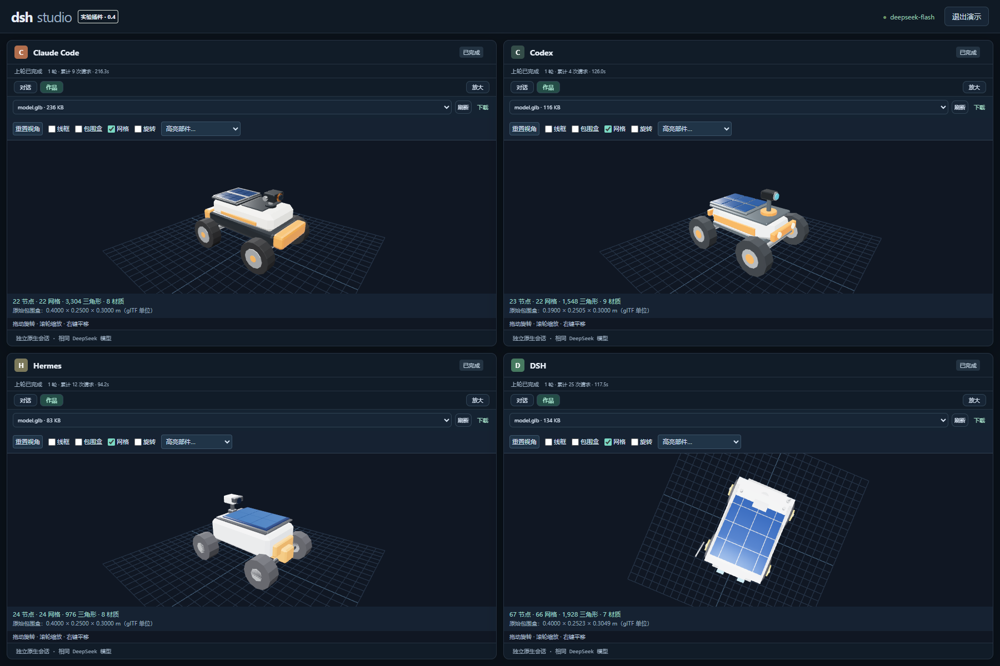

# DSH Studio

[简体中文](README.zh-CN.md) · [Documentation](docs/README.md) · [Installation](docs/installation.md) · [Architecture](docs/architecture.md)

A DSH plugin for drawable workspaces and side-by-side harness conversations using the same DeepSeek model.

- **Draw a workspace:** compose chat, file-list, file-preview and note components with rectangles or a freehand sketch.
- **Recognize sketches:** ask DeepSeek Flash to propose a layout, preview it, then adopt and explicitly save it.
- **Compare four real harnesses:** broadcast a prompt to Claude Code, Codex, Hermes and DSH. Each lane resumes its own native session and has its own files.
- **Keep the core separate:** the plugin mounts through a DSH overlay and runs in a dedicated profile home. It does not patch the DSH agent loop.

This is an experimental Linux/Docker project. Windows users can run the execution host in WSL2 or on a Linux server and open the UI in a browser. It is an interactive comparison, not a controlled performance benchmark: tool sets, prompts, reasoning policies and protocol behavior differ across harnesses.



## Quick start

Prerequisites: Node 24 in a dedicated runtime directory, Git, Docker, uv and a prepared [DSH checkout](https://github.com/deepseek-ai/deepseek-harness) with its dependencies installed. Do not use a whole system directory such as `/usr` as a runtime mount. See [installation](docs/installation.md) for the tested DSH revision and configuration fields.

```bash
git clone https://github.com/ckqqqq/dsh-studio.git
cd dsh-studio
npm run install:harnesses
docker build -t dsh-studio-runtime:0.4 deploy
docker image inspect --format '{{.Id}}' dsh-studio-runtime:0.4
cp examples/config.json settings.json
```

Edit `settings.json`: set the DSH and Node runtime paths and the image digest printed by Docker. The Python runtime directory is created by the installer. Then provision your key without putting its value in shell history:

```bash
read -rsp 'DeepSeek API key: ' DEEPSEEK_API_KEY; echo
export DEEPSEEK_API_KEY
npm run configure -- settings.json
unset DEEPSEEK_API_KEY
npm run doctor
npm start
```

The first configure invocation creates an owner-only key file. Later invocations reuse that file: leave the environment variable unset, or provide a different explicit `keyFile` path. Configuration never overwrites an existing key file.

Open `http://127.0.0.1:3081/` and enter the code from `data/access.token`. For another machine, use an SSH tunnel or explicitly configure the UI bind address. Only expose the UI port; the model relay belongs on the Docker bridge. `settings.json`, generated configuration, keys and runtime data are ignored by Git.

## Workflow

In **Four-pane comparison**, send a shared prompt. On a new conversation, public input files are copied into four separate workspaces. Subsequent changes stay in their lane. Stop cancels the current containers; reload reconnects to the active job in the same browser session.

In **Whiteboard**, draw rectangles and select a component type, or use the freehand pen and describe the desired layout. **Recognize sketch** sends only the generated sketch, component titles, layout and description to DeepSeek. Conversation text, file contents and note bodies are omitted. Recognition previews a proposal; adoption changes the browser draft; **Save layout** persists it. Layout export/import includes the strokes. Notes and strokes are browser-local.

## Development

```bash
npm test
npm run check
```

These commands require no model credentials or installed harnesses. CI runs them on Node 24/Linux. Tests cover layout validation, file confinement, native event projection, configuration and sketch response handling. Real-model integration evidence from the initial prototype is summarized in [validation](docs/validation.md); private transcripts, access codes and deployment-specific screenshots are deliberately absent from this repository.

## Execution and privacy

Run the execution host as a non-root user. Each turn uses that host UID in a Docker container with a read-only root, dropped capabilities, resource limits and only a private writable home/workspace. Runtimes mount read-only. The Docker socket and real API key are not mounted. Active turns receive relay credentials which are revoked at turn end. Tool network access is available through Docker's bridge network.

The UI access code controls API access. Native histories and files stay in `data/conversations`; successful sketch requests, including the sketch image and description, stay in `data/proposals`. Do not commit or share those directories. Read [security and deployment](SECURITY.md) before exposing the UI beyond a trusted machine or LAN.

## Limits

- The renderer supports four component types; it does not execute model-generated HTML, JavaScript or arbitrary new components.
- No model-weight training or self-improvement is implemented.
- Downstream CLIs use version-sensitive interfaces; dependency pins are in `examples/` and `THIRD_PARTY_NOTICES.md`.
- DSH thinking is disabled in this prototype; other harnesses retain their native policies. Same-model runs are not equal-budget evaluations.
- The relay request budget is per lane/turn. Timing and usage availability depend on each CLI; missing usage remains unknown.
- The execution host requires Linux and Docker. The supplied systemd service is a template.

## License

MIT for Studio code. Downstream harnesses and runtime dependencies retain their own licenses and terms; see [third-party notices](THIRD_PARTY_NOTICES.md).

### Artifact previews and request budgets

Version 0.3 adds interactive self-contained HTML, MP4/WebM playback and image previews in each lane, with expansion and download controls. The runtime image includes ffmpeg, Pillow, numpy and Noto CJK fonts. Defaults are 64 admitted inference requests and 900 seconds per lane/turn. Budget exhaustion preserves partial output, files and sessions; rejected retries and token estimates do not count.

Previews are immutable snapshots created after the lane stops, limited to 100 MiB per file and 32 active links, expiring after 600 seconds. HTML runs in an opaque-origin sandbox with network access blocked; use inline CSS/JS and data resources. Refresh an expired preview to create a new link.

### Generic 3D artifacts

Version 0.4 adds a locally bundled Three.js viewer for uncompressed GLB and self-contained glTF 2.0. Orbit, pan, zoom, wireframe, bounds, part highlighting and auto-fit work independently of case names. The image includes Blender. External model URIs and unsupported required decoder extensions are rejected before loading; geometry, texture pixels, graphs and animation allocations are bounded.

Six declarative cases in `examples/3d-cases.json` cover mechanical voids, furniture scale, hollow curves, articulated assemblies, multi-part vehicles and room scenes. Run `node scripts/run-3d-cases.mjs --config config.local.json` to broadcast cases to four native CLIs and independently inspect the exported models in networkless containers. Native completion, format admission and listed geometric constraints are separate results. Reports remain in private `data/case-runs/`.

The checked-in viewer bundle is built with `npm ci && npm run build:viewer`. Optional Blender negative controls are in `test/fixtures/model-negative.py`; they are synthetic validator tests, not harness performance results.

### Cordis case plugins

Studio provides `studioModelCases` for owned, disposable registrations from sibling Cordis plugins. See [plugin development](docs/plugins.md) and the [runnable example](examples/plugins/model-case/README.md). Case registration alone does not call a model or install code.
