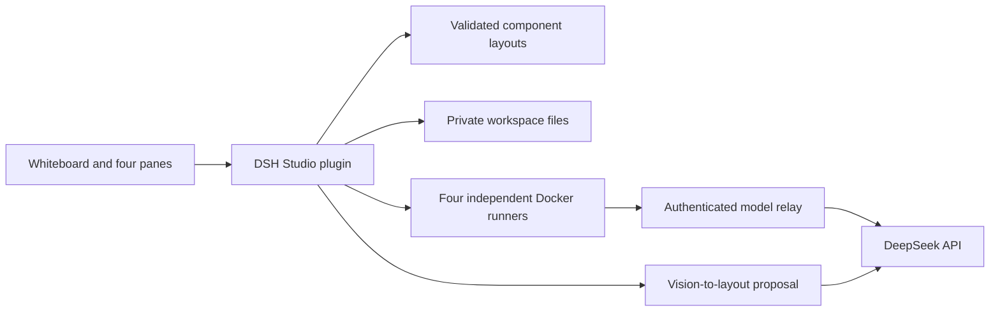

# Architecture

`src/index.mjs` is the Cordis plugin entry. Its listeners, runtime and pending sketch request are disposed with the plugin. It exports no alternate DSH application launcher. `scripts/start.mjs` delegates to DSH's supported profile launcher.

`src/runtime.mjs` owns conversations, native session ids, jobs, child processes and temporary relay grants. Each new conversation copies the public input seed into four workspaces. Each turn starts a container with a persistent lane-specific home and resumes that lane's native session. Native JSONL is projected into UI state and retained privately. A clean process exit alone is not a successful native completion.

The relay accepts credentials only for active turns, forwards a fixed set of DeepSeek endpoints, rejects another model id and enforces the request cap. It does not synthesize responses or rewrite tool schemas. The real key remains outside mounted runtime trees. Tools can access the network through Docker's bridge; this is not an egress-restricted sandbox.

`src/layout.mjs` validates a declarative registry of `chat`, `files`, `preview`, `note`. `src/files.mjs` checks workspace-relative paths, rejects links, and bounds text reads/writes. UI text is inserted with text nodes, not model-controlled HTML.

`src/sketch.mjs` accepts bounded inline PNGs and calls DeepSeek's vision API with JSON output. Only sketch lines, component titles, layout and the user's design instruction are included. Valid outputs are proposals: recognition and adoption do not persist the layout; an explicit save does. Successful inputs/outputs are stored in the private proposals directory.

## Generated artifacts

`src/artifacts.mjs` discovers bounded HTML, video and image outputs. The runtime holds a workspace read lease while copying an output to a private immutable snapshot; new runs cannot start during that copy. Preview links grant access to one snapshot for a limited time, not to a directory or the Studio access code. HTML uses both iframe sandboxing without same-origin permission and a response CSP that blocks network and parent-frame access. Video responses support single byte ranges for seeking. Previews are offered after the owning container has been removed, and orphaned writers prevent previews.

Native streams have a 64 MiB per-lane cap because reasoning and progress events can be much larger than the final answer. The DSH adapter allows up to 32768 output tokens per inference request and projects native truncation into an explicit resumable status. These are integration limits, not a normalization of every downstream harness's reasoning or token policy.

## Generic 3D path

Model discovery uses extensions, not case names. `src/model.mjs` is a pure admission policy shared by immutable server snapshots and the browser. The bundled viewer uses trusted Three.js/GLTFLoader code in an opaque-origin iframe. Its only capability is an expiring artifact URL; CSP and pre-load validation reject external resources. Scene bounds determine centering and scale, while metrics retain original dimensions. Orbit, wireframe and part highlighting operate on the loaded scene graph.

Case briefs and predicates live in `examples/3d-cases.json`. The runner broadcasts the same brief to native harnesses, waits for cleanup, snapshots output through the authenticated preview API, and invokes a separate networkless Blender inspector. Criteria and report directories are outside generative workspaces. Native completion, format admission and geometric predicate results remain separate. `--recheck` reuses existing conversations and repeats only inspection, without inference calls.

## Cordis model-case service

The Studio fiber provides `studioModelCases`. Built-in data and sibling plugins register owned packs through the same pure registry. Consumers declare injection and bind their registration disposer to `ctx.effect`; unloading or service replacement removes their entries. HTTP catalog requests read current registrations. This seam covers 3D tasks and supported predicates, while native harness execution and browser component types retain their existing boundaries. See the [plugin contract](plugins.md).
