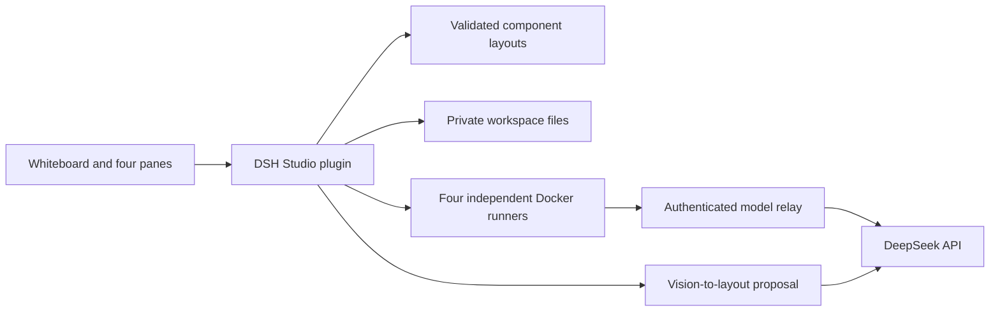

# Architecture

`src/index.mjs` is the Cordis plugin entry. Its listeners, runtime and pending sketch request are disposed with the plugin. It exports no alternate DSH application launcher. `scripts/start.mjs` delegates to DSH's supported profile launcher.

`src/runtime.mjs` owns conversations, native session ids, jobs, child processes and temporary relay grants. Each new conversation copies the public input seed into four workspaces. Each turn starts a container with a persistent lane-specific home and resumes that lane's native session. Native JSONL is projected into UI state and retained privately. A clean process exit alone is not a successful native completion.

The relay accepts credentials only for active turns, forwards a fixed set of DeepSeek endpoints, rejects another model id and enforces the request cap. It does not synthesize responses or rewrite tool schemas. The real key remains outside mounted runtime trees. Tools can access the network through Docker's bridge; this is not an egress-restricted sandbox.

`src/layout.mjs` validates a declarative registry of `chat`, `files`, `preview`, `note`. `src/files.mjs` checks workspace-relative paths, rejects links, and bounds text reads/writes. UI text is inserted with text nodes, not model-controlled HTML.

`src/sketch.mjs` accepts bounded inline PNGs and calls DeepSeek's vision API with JSON output. Only sketch lines, component titles, layout and the user's design instruction are included. Valid outputs are proposals: recognition and adoption do not persist the layout; an explicit save does. Successful inputs/outputs are stored in the private proposals directory.
